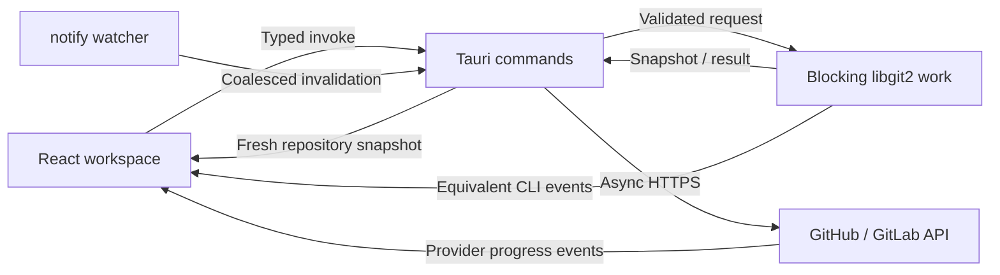

# Application architecture

GitSomething separates interface intent, native repository work, provider APIs, and explanatory output. React owns presentation and user intent. Rust owns filesystem access, Git state, validation, mutations, and provider credentials. The Glass-Box console describes what the engine did using equivalent CLI syntax.

## Product name and compatibility

The product is named GitSomething. The existing native identifier `dev.branchline.desktop`, `branchline.*` preference keys, OS credential-store service `com.branchline.desktop.github`, and `BRANCHLINE_GITHUB_CLIENT_ID` configuration keep their original names so installed preferences and GitHub sign-in remain available after the rename. These are compatibility identifiers rather than names shown in the interface. The `BRANCHLINE_TEST_URL` test-server override is also unchanged.

## Data and control flow



The event path is informational. An event carrying a command string must not become an executable capability. Provider requests are identified as provider requests because `git init` cannot create a hosted repository.

## Native engine

`src-tauri/src/main.rs` is the small platform binary entry point. `lib.rs` configures the Tauri builder, manages the engine state, and registers the explicit IPC surface. `git_engine.rs` contains the repository operations; `github_auth.rs` owns device authorization and native credential storage. As complexity grows, split the Git engine by responsibility into repository sessions, status/diff reads, index operations, history, remotes/providers, watcher lifecycle, and safety planning. Keep DTOs independent of borrowed libgit2 handles.

Do not store `Commit<'repo>`, `Tree<'repo>`, `Diff<'repo>`, or borrowed credential data outside the repository lifetime that created them. Open the `Repository` inside the blocking closure, produce owned DTOs, and release handles before returning to the async runtime. This keeps non-`Sync` handles and borrowed C data out of shared UI-facing state.

`AppState` stores async mutation gates keyed by canonical worktree root. Git commands acquire the repository's gate; publishing holds it across its local and provider phases. This serializes work on one repository without blocking unrelated repositories. Watchers are also keyed by canonical root and retained until application shutdown. For future worktrees, extend gate identity to account for the shared Git directory as well as separate indexes; add explicit repository-session closing to release watchers earlier.

## IPC and events

Use commands for validated requests and typed terminal results; use events for incremental progress and invalidation. Tauri events carry JSON and are not intrinsically type-safe, so define matching DTOs and validate payload boundaries. [Tauri's command/event documentation](https://v2.tauri.app/develop/calling-rust/) describes those differences.

A publishing component must await listener registration before invoking the backend. It allocates an `operationId`, subscribes, starts the operation with the same ID, and ignores events for other operations. Registering a listener after invocation can lose the first progress step. Remove listeners on completion or unmount; do not create another listener on every render.

Each operation should expose an ID, phase, human-readable message, optional equivalent command, timestamp, and terminal success/failure. Never include a token, Authorization header, credential-bearing URL, or raw provider response containing secrets. The terminal command result remains authoritative if a view is closed or a progress event is missed.

Repository invalidation is different from operation progress. Coalesce watcher events into one fresh snapshot and discard a superseded result after the user switches repositories. Keep progress for a long operation visible independently of the currently selected file.

The first milestone registers these commands:

| Command                                                    | Inputs                        | Purpose                                                                                   |
| ---------------------------------------------------------- | ----------------------------- | ----------------------------------------------------------------------------------------- |
| `open_repository`                                          | `path`                        | Open a repository and return a snapshot.                                                  |
| `get_diff`                                                 | `path`, `filePath`, `staged?` | Return the selected side's owned text diff data; omitted `staged` defaults to `false`.    |
| `stage_file` / `unstage_file`                              | `path`, `filePath`            | Mutate the selected file's index state.                                                   |
| `commit_changes`                                           | `path`, `message`             | Commit the staged index.                                                                  |
| `create_rescue_branch`                                     | `path`, `name`                | Create a new branch at the current commit and attach HEAD without changing working files. |
| `fetch_repository` / `push_repository` / `pull_repository` | `path`                        | Synchronize the configured remote; pull accepts only a safe fast-forward.                 |
| `publish_repository`                                       | `request`                     | Validate, initialize, commit, create a hosted repository, connect, and push.              |
| `github_auth_status`                                       | none                          | Report configured/connected state and account details without credentials.                |
| `github_auth_configure`                                    | `clientId`                    | Validate and persist the public OAuth app identifier for one-time owner setup.            |
| `github_auth_open_setup`                                   | none                          | Open the fixed GitHub OAuth app registration page in the system browser.                  |
| `github_auth_start`                                        | none                          | Request a one-time user code and keep the private device code in Rust.                    |
| `github_auth_poll`                                         | `sessionId`                   | Poll a valid session while respecting the provider's minimum interval.                    |
| `github_auth_open_browser`                                 | `sessionId`                   | Open the fixed GitHub approval page for the active native session.                        |
| `github_auth_cancel`                                       | `sessionId`                   | Cancel the local sign-in session and prevent later completion.                            |
| `github_auth_disconnect`                                   | none                          | Remove the saved local GitHub credential and connected account.                           |
| `list_github_repositories`                                 | `request: { page, perPage }`  | Read a bounded page of repositories accessible to the native authenticated account.       |
| `open_github_repository`                                   | `url`                         | Validate an HTTPS GitHub repository URL and open it in the system browser.                |

The publishing request uses camelCase:

```ts
type PublishRequest = {
  path: string;
  name: string;
  private: boolean;
  provider: 'github' | 'gitlab';
  token: string; // Empty for GitHub; supplied only for an operation-scoped GitLab token.
  authorName: string;
  authorEmail: string;
  operationId: string;
};
```

`git:log` carries `{ id, operationId, tokens: [{ text, explanation }], status, message?, timestamp }`. `publish:progress` carries `{ operationId, step, status, message?, url? }`, with `step` one of `validate`, `init`, `commit`, `remote`, `push`, or `done`. `repo:changed` carries `{ path }` and requests a fresh snapshot rather than sending borrowed native state. A successful publish returns `{ url, path, branch }`.

The terminal merges native Git logs with explicit `command` and `operation` activities. Guided commands settle their output in place; repository failures and real auth or publishing lifecycles use operation events. Scope comes from the event kind, never Git-related words in a button label. `ActivityProvider` drops interface events before storage and installs no document-wide click/change recorder. It retains only the latest lesson as inspector context; lesson events never enter the transcript. `GlassBox` independently filters eligible kinds and offers All operations, Commands, and Events. Navigation, scrolling, resizing, settings, copying, panel openings, and slider confirmations produce no rows. A real Git read triggered by file review remains eligible.

A snapshot can contain two rows with the same path: `{ path, staged: true }` for HEAD→index and `{ path, staged: false }` for index→worktree. Additions and deletions are calculated for that side. Selection and row identity include both path and staged state; the workspace's changed-file count deduplicates paths. `get_diff(path, filePath, true)` previews exactly the staged content that a commit includes. The explicit unstaged request preserves visibility of edits made after staging.

## Folder to cloud

1. Receive a native folder drop or directory-dialog selection. Browser drag data is not a trusted native path.
2. Canonicalize and inspect the directory in Rust. The starter rejects existing/nested repositories, invalid names, obvious credential filenames, files above 50 MiB, and scans above 100,000 files before creating a hosted repository.
3. Authenticate the selected provider account and check that the requested repository name is available before mutating the folder. These checks reduce avoidable failures; they cannot reserve the name or prove a later create request will succeed.
4. Initialize the local repository and create the initial commit using explicit identity. Respect ignored files and do not create a nested repository accidentally.
5. Create the hosted repository through the selected provider's HTTPS API. For GitHub, the native backend retrieves the remembered OAuth credential; for GitLab, it uses the token supplied for that operation.
6. Retain the returned hosted URL in progress/recovery messages, add `origin`, push the initial branch, and set upstream tracking only after push success. Validate the effective push URL and each credential callback against the selected provider's HTTPS host, disallowing other ports, userinfo, query strings, and fragments; publishing transport disables redirects.
7. Return `{ path, branch, url }` on success. If starting the watcher fails after a completed push, retain success and explain how to reopen the repository to retry automatic refresh. If an earlier phase fails, preserve completed phases and show recovery context. Resuming a partially published repository is currently manual; the dialog does not reinitialize or adopt an existing repository.

The privacy selection is explicit; a project can default to private without removing the choice. Keep tokens out of localStorage, frontend persistence, URLs, telemetry, and command explanations. The frontend sends an empty token field for GitHub publication and never receives the OAuth access token.

GitHub.com and GitLab.com are the supported hosts. Subsequent GitHub HTTPS synchronization uses the native OAuth credential with the same destination validation; SSH-agent/default credential support remains available for other configured transports. GitLab's manual publishing credential is not a remembered account connection. The initial text diff endpoint accepts UTF-8 files up to 2 MiB and reports unsupported binary/large content rather than sending it to Monaco.

## First-use guide and GitHub account state

`HomePage` is the initial route. It offers explicit open, publish, demo, and guide actions; it does not mount Monaco before a workspace is first entered. Recent repository metadata is validated and bounded to eight entries under `branchline.recent-repositories.v1`. Successful native opens refresh this list; failed opens stay on Home. Removing a recent entry only removes its shortcut. Returning Home retains the visited workspace under a hidden, inert container, preserving its in-memory draft, selected file, tab, and terminal session. Repository-specific commit drafts remain in memory when switching projects.

`src/workspace-layout.css` defines a content-first split workspace. The changed-file list and commit composer share the left column; the diff spans both rows in the right column. The working view omits the activity rail and large masthead; `BranchJourney` appears in History. Primary file labels use 13px text and Monaco uses 14px code. At widths of 1000px or less the repository sidebar hides automatically; at 760px or less the files, diff, and composer stack in a scrollable workspace.

`src/lib/workspace-layout.ts` validates saved widths and sidebar visibility under `gitsomething.workspace-layout.v1`. Repository width defaults to 224px within 190–320px, and changed-file width defaults to 304px within 248–420px. Runtime measurements lower the effective width limits to protect available editor space, with a 440px editor target for the file split. `WorkspaceSplitHandle` supports pointer and keyboard resizing; completed gestures persist layout without repository content or credentials and add no terminal entries. Storage failures leave controls usable in memory. This web layout follows [Apple's split-view](https://developer.apple.com/design/human-interface-guidelines/split-views) and [sidebar](https://developer.apple.com/design/human-interface-guidelines/sidebars/) patterns without using native AppKit views.

`FirstRunGuide` introduces the workspace in four steps: Welcome, Connect, Try it, and Your project. Practice staging, committing, and pushing changes only local React state and is labeled as a simulation. Home offers the guide without automatically opening a modal. Closing or completing it retains the independent `branchline.guide.v1=seen` preference. It can be opened from Home, Help, or the command palette; the account launcher opens its Connect step. The final Explore action enters the current workspace or an explicit practice workspace.

The Glass Box stores validated height and font preferences under `branchline.terminal.v1`; denied or malformed storage falls back to in-memory defaults. The fresh body height is 180px without migrating valid saved heights. A pointer-captured separator and keyboard controls resize its body, with live host measurements reserving 260px for the desktop workspace or 200px at widths of 760px or less. Measurements exclude the flexible workspace and terminal body to avoid a resize feedback loop. The terminal starts collapsed in windows shorter than 720px, and its learning inspector starts closed until requested. Workspace learning tips use an anchored popover rather than consuming additional layout height. Resizing and appearance changes leave the transcript unchanged. Text size is limited to 12–18px and affects commands, output, and input. Preferences contain no repository content or credentials.

`GitHubAuthProvider` shares account state across the guide, account launcher, and publishing dialog. It invokes the native auth commands, schedules polls using the returned interval, and discards responses from canceled or superseded sessions. The native backend also enforces session identity and polling intervals; frontend timers alone cannot enforce these boundaries. React receives only account details, scopes, the public user code, and flow status. Rust owns the private device code, access token, refresh token when issued, and credential-store lifecycle. The sign-in URL is fixed in Rust rather than accepting an arbitrary URL from the webview.

The owner's OAuth Client ID is public configuration. In-app owner setup validates it and writes `github-oauth.json` in Tauri's application configuration directory. This setting takes precedence over `BRANCHLINE_GITHUB_CLIENT_ID`, which can still be read at runtime or embedded during the native build. A missing identifier offers the owner setup form while preserving local Git work. Setup changes require a disconnected account and no pending authorization. Registration is the application owner's responsibility; people installing a configured build sign in directly. [GitHub sign-in setup](GITHUB_AUTH.md) documents registration, permissions, and the live verification boundary.

`GitHubRepositories` adds the authenticated provider list to Home. `useGitHubRepositories` invokes Rust with `{ request: { page, perPage } }` and receives `{ repositories, nextPage, accountLogin }`. Each row contains repository metadata, never credentials or file contents. Rust calls the fixed authenticated GitHub endpoint with the native OAuth credential. It requests owner, collaborator, and organization-member affiliation, sorts by update time, and bounds page size. The interface requests 50 rows per page; filtering searches only loaded metadata. Duplicate repository IDs across pages replace metadata without duplicating rows.

The account login and auth-provider revision define a frontend repository session. The hook hides rows immediately when that identity changes, discards superseded responses, and rejects a response whose `accountLogin` differs from the active account. Search and open-link state reset with the same session. Lists are not written to browser storage. GitHub repository links open through a native command that validates the HTTPS host and repository path; this action does not clone a repository. Failed page requests retain loaded current-account data with a retry action. Browser previews show the desktop requirement rather than invented account repositories.

## Git Guardian and destructive plans

Read repository state using libgit2, then derive concise advice for detached HEAD, merge/rebase state, conflicts, ahead/behind state, and unborn HEAD. Some reads can fail on corrupt or inaccessible repositories; show that failure instead of deriving a fabricated healthy state.

The starter's `create_rescue_branch` re-reads the current commit under the repository gate, validates the complete branch reference, refuses to overwrite an existing branch, and attaches HEAD to the new branch without checking out different files. Working edits are preserved. Merge/rebase conflicts must currently be completed outside the app; three-way resolution and merge-commit creation are not implemented. A state banner does not authorize discarding files or rewriting history.

Future destructive operations use a two-phase plan. The backend computes affected files/commits and records the relevant HEAD, index, worktree, and remote expectations. The UI presents that plan. Execution rechecks its preconditions and rejects stale plans. A force push uses an expected remote OID equivalent to a lease; a confirmation alone does not make an unrestricted force push safe.

## Partial staging roadmap

Monaco supplies selected ranges and displays staged versus unstaged content; it does not itself stage Git lines. Selected hunk staging can use `Repository::apply` targeting the index and `ApplyOptions::hunk_callback`. The git2 0.21 wrapper exposes hunk and delta callbacks, not an apply-line callback. Selected-line staging therefore requires constructing a valid filtered patch with correct context and applying it against a revalidated baseline. [git2 ApplyOptions](https://docs.rs/git2/0.21.0/git2/struct.ApplyOptions.html) documents the available callbacks.

Test patch semantics for deleted files, CRLF, missing final newlines, encodings, renames, binary content, stale index contents, and overlapping external edits before enabling line staging. Until that implementation exists, file-level stage/unstage must not be presented as partial staging.

## Performance and scale

In-process index and object reads eliminate shell startup and text-output parsing. Status still depends on filesystem metadata and ignore rules; diffs depend on content and algorithmic work; network operations depend on transport. Avoid universal sub-millisecond claims.

For monorepos, bound history and file contents, virtualize long lists, detect binary files before sending text to Monaco, page history, coalesce watcher bursts, and cancel or discard superseded reads. Measure native workloads independently from the browser fixture. The UI must remain responsive while Rust performs blocking work.

See [ADR 0001](adr/0001-native-git-runtime.md) for serialization, resource lifetimes, security boundaries, and recovery decisions.
