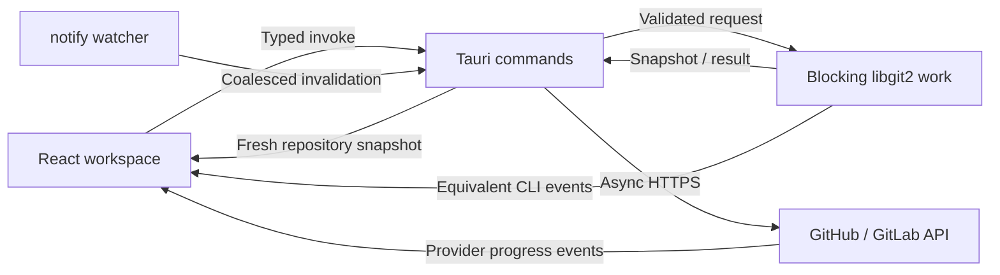

# Application architecture

Branchline separates interface intent, native repository work, provider APIs, and explanatory output. React owns presentation and user intent. Rust owns filesystem access, Git state, validation, mutations, and network credentials during an operation. The Glass-Box console describes what the engine did using equivalent CLI syntax.

## Data and control flow



The event path is informational. An event carrying a command string must not become an executable capability. Provider requests are identified as provider requests because `git init` cannot create a hosted repository.

## Native engine

`src-tauri/src/main.rs` is the small platform binary entry point. `lib.rs` configures the Tauri builder, manages the engine state, and registers the explicit IPC surface. `git_engine.rs` contains the first milestone's repository operations. As complexity grows, split it by responsibility into repository sessions, status/diff reads, index operations, history, remotes/providers, watcher lifecycle, and safety planning. Keep DTOs independent of borrowed libgit2 handles.

Do not store `Commit<'repo>`, `Tree<'repo>`, `Diff<'repo>`, or borrowed credential data outside the repository lifetime that created them. Open the `Repository` inside the blocking closure, produce owned DTOs, and release handles before returning to the async runtime. This keeps non-`Sync` handles and borrowed C data out of shared UI-facing state.

A repository session owns the selected canonical path, a mutation gate, the watcher and refresh worker, operation metadata, and snapshot revision. The starter may use a conservative application-wide gate while one repository is active. Multiple simultaneous repositories should move to gates keyed by canonical repository identity and shared Git directory, especially for worktrees.

## IPC and events

Use commands for validated requests and typed terminal results; use events for incremental progress and invalidation. Tauri events carry JSON and are not intrinsically type-safe, so define matching DTOs and validate payload boundaries. [Tauri's command/event documentation](https://v2.tauri.app/develop/calling-rust/) describes those differences.

A publishing component must await listener registration before invoking the backend. It allocates an `operationId`, subscribes, starts the operation with the same ID, and ignores events for other operations. Registering a listener after invocation can lose the first progress step. Remove listeners on completion or unmount; do not create another listener on every render.

Each operation should expose an ID, phase, human-readable message, optional equivalent command, timestamp, and terminal success/failure. Never include a token, Authorization header, credential-bearing URL, or raw provider response containing secrets. The terminal command result remains authoritative if a view is closed or a progress event is missed.

Repository invalidation is different from operation progress. Coalesce watcher events into one fresh snapshot and discard a superseded result after the user switches repositories. Keep progress for a long operation visible independently of the currently selected file.

The first milestone registers these commands:

| Command | Inputs | Purpose |
| --- | --- | --- |
| `open_repository` | `path` | Open a repository and return a snapshot. |
| `get_diff` | `path`, `filePath` | Return the selected file's owned text diff data. |
| `stage_file` / `unstage_file` | `path`, `filePath` | Mutate the selected file's index state. |
| `commit_changes` | `path`, `message` | Commit the staged index. |
| `fetch_repository` / `push_repository` / `pull_repository` | `path` | Synchronize the configured remote; pull accepts only a safe fast-forward. |
| `publish_repository` | `request` | Validate, initialize, commit, create a hosted repository, connect, and push. |

The publishing request uses camelCase:

```ts
type PublishRequest = {
  path: string
  name: string
  private: boolean
  provider: 'github' | 'gitlab'
  token: string
  authorName: string
  authorEmail: string
  operationId: string
}
```

`git:log` carries `{ id, operationId, tokens: [{ text, explanation }], status, message?, timestamp }`. `publish:progress` carries `{ operationId, step, status, message?, url? }`, with `step` one of `validate`, `init`, `commit`, `remote`, `push`, or `done`. `repo:changed` carries `{ path }` and requests a fresh snapshot rather than sending borrowed native state. A successful publish returns `{ url, path, branch }`.

## Folder to cloud

1. Receive a native folder drop or directory-dialog selection. Browser drag data is not a trusted native path.
2. Canonicalize and inspect the directory in Rust. The starter rejects existing/nested repositories, invalid names, obvious credential filenames, files above 50 MiB, and scans above 100,000 files before creating a hosted repository.
3. Initialize the local repository and create the initial commit using explicit identity. Respect ignored files and do not create a nested repository accidentally.
4. Create the hosted repository through the selected provider's HTTPS API using an operation-scoped credential.
5. Record the returned remote identity for the operation, add or verify `origin`, push the initial branch, and set upstream tracking only after push success.
6. Return an owned result containing local path, branch, hosted URL, and completed steps. If a later phase fails, preserve successful phases and provide a recovery explanation.

The privacy selection is explicit; a project can default to private without removing the choice. Keep tokens out of localStorage, frontend persistence, URLs, telemetry, and command explanations. The starter's manual token entry is not a complete OAuth sign-in system.

GitHub.com and GitLab.com are the supported first-milestone hosts. Subsequent synchronization uses existing libgit2 SSH-agent/default credential support; manual publishing credentials are not a remembered account connection. The initial text diff endpoint accepts UTF-8 files up to 2 MiB and reports unsupported binary/large content rather than sending it to Monaco.

## Git Guardian and destructive plans

Read repository state using libgit2, then derive concise advice for detached HEAD, merge/rebase state, conflicts, ahead/behind state, and unborn HEAD. Some reads can fail on corrupt or inaccessible repositories; show that failure instead of deriving a fabricated healthy state.

Safe rescue actions have backend preconditions. Before creating a branch from detached HEAD, for example, re-read HEAD and ensure it still matches the state the user reviewed. A state banner is not authorization to force checkout, discard files, or rewrite history.

Future destructive operations use a two-phase plan. The backend computes affected files/commits and records the relevant HEAD, index, worktree, and remote expectations. The UI presents that plan. Execution rechecks its preconditions and rejects stale plans. A force push uses an expected remote OID equivalent to a lease; a confirmation alone does not make an unrestricted force push safe.

## Partial staging roadmap

Monaco supplies selected ranges and displays staged versus unstaged content; it does not itself stage Git lines. Selected hunk staging can use `Repository::apply` targeting the index and `ApplyOptions::hunk_callback`. The git2 0.21 wrapper exposes hunk and delta callbacks, not an apply-line callback. Selected-line staging therefore requires constructing a valid filtered patch with correct context and applying it against a revalidated baseline. [git2 ApplyOptions](https://docs.rs/git2/0.21.0/git2/struct.ApplyOptions.html) documents the available callbacks.

Test patch semantics for deleted files, CRLF, missing final newlines, encodings, renames, binary content, stale index contents, and overlapping external edits before enabling line staging. Until that implementation exists, file-level stage/unstage must not be presented as partial staging.

## Performance and scale

In-process index and object reads eliminate shell startup and text-output parsing. Status still depends on filesystem metadata and ignore rules; diffs depend on content and algorithmic work; network operations depend on transport. Avoid universal sub-millisecond claims.

For monorepos, bound history and file contents, virtualize long lists, detect binary files before sending text to Monaco, page history, coalesce watcher bursts, and cancel or discard superseded reads. Measure native workloads independently from the browser fixture. The UI must remain responsive while Rust performs blocking work.

See [ADR 0001](adr/0001-native-git-runtime.md) for serialization, resource lifetimes, security boundaries, and recovery decisions.
